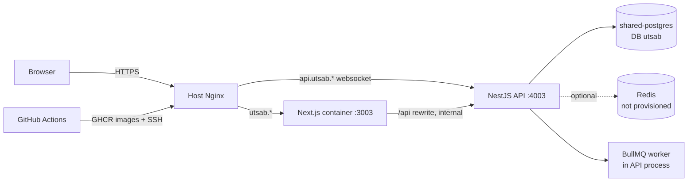

# Event & Wedding Management ("Utsab") — Architecture Inventory

Audited commit: `19e6734` (main, 2026-11-13). 166 tracked files. Evidence is static (source read); nothing here was inferred from documentation alone.

## 1. Repository layout

| Path | Contents |
|---|---|
| `backend/` | NestJS API, Prisma schema + 5 migrations, seed, node:test tests, docs, an **inactive** CI file at `backend/ci/workflows/ci.yml` |
| `frontend/` | Next.js App Router app, Playwright specs |
| `deploy/` | `docker-compose.prod.yml`, `.env.example`, README for the EC2 host |
| `.github/workflows/deploy.yml` | Build images → push GHCR → SSH deploy to EC2 on every push to `main` |
| `.gitignore` (root) | `config.bat`, `node_modules` — added by the attacker's commit, see `security-audit.md` §1 |

## 2. Technology inventory

| Layer | Technology (version from `package.json`) |
|---|---|
| Runtime | Node `>=22` (Docker `node:24-alpine`) |
| API framework | NestJS 11 on Express 5 (`@nestjs/platform-express`) |
| ORM / DB | Prisma 6.19, PostgreSQL (dev compose `postgres:17-alpine`; production README says shared Postgres 16) |
| Validation | zod 4 (`backend/src/validation.ts`). `class-validator` / `class-transformer` are installed but unused |
| Auth | `@nestjs/jwt` HS256, 8 h expiry, `bcryptjs` cost 12, bearer token |
| Realtime | `socket.io` 4.8 (`backend/src/realtime.ts`) |
| Jobs | `bullmq` 5 inside the API process, only when `REDIS_URL` is set (`backend/src/jobs.ts:12`) |
| Security middleware | `helmet`, CORS allowlist, in-memory rate limiter (`backend/src/rate-limit.ts`) |
| Frontend | Next.js 16, React 19, plain CSS (9,347 lines across 3 global files), `lucide-react`, `socket.io-client`, `qrcode`, `@zxing/browser` |
| State management | One React context (`frontend/src/lib/context.tsx`) + `useResource` fetch hook |
| Tests | `node:test` via `tsx` (4 backend files), Playwright (3 specs, desktop viewport only) |
| Package manager | npm with lockfiles in both apps |

## 3. Backend architecture

Single `AppModule` in `backend/src/main.ts` registers **34 controllers** and 4 providers (`Database`, `AuthGuard`, `Jobs`, global `RateLimit` guard). There is **no service layer**: every controller injects the Prisma client and holds validation, authorization, business rules and queries in the handler. Shared logic lives in plain functions:

| File | Role |
|---|---|
| `access.ts` | `ownEvent` / `ownVendor` permission checks, `eventAccess` / `vendorAccess` filters |
| `reservations.ts` | `reserve()` — the booking hold transaction used by bookings and cart |
| `domain.ts` | money, commission, overlap, package price helpers |
| `reminders.ts`, `automations.ts` | Functions run by the job worker |
| `activity.ts` | `audit()` activity-log writer |
| `errors.ts` | Global exception filter (maps P2002/P2025/P2003) |
| `event-templates.ts` | Static occasion templates (checklists, budget splits) |

Authentication guard is applied per controller with `@UseGuards(AuthGuard)`; nine controllers are intentionally unguarded at class level (`auth`, `categories`, `event-types`, `rsvp`, `health`, `packages`, `payments`, `vendors`, `public/sites`) and guard individual routes inline.

## 4. API inventory (all under `/api`)

| Area | Routes | File |
|---|---|---|
| Auth | `POST auth/register`, `POST auth/login` | `auth.ts` |
| Events | `GET/POST events`, `GET/PATCH events/:id`, `POST events/:id/days`, `POST events/:id/tasks`, `PATCH events/:id/tasks/:taskId` | `events.ts` |
| Guests | `GET/POST events/:id/guests`, `POST …/import`, `PATCH …/:guestId` (table label only) | `guests.ts` |
| RSVP (public) | `GET/POST rsvp/:token` | `guests.ts` |
| Budget | `GET events/:id/budget`, `PUT …/:category`, `POST …/expenses` | `budget.ts` |
| Seating | `GET events/:id/seating`, `POST/PATCH/DELETE …/tables`, `POST …/assign` | `seating.ts` |
| Run sheet | `GET/POST events/:id/run-sheet`, `PATCH/DELETE …/:itemId` | `run-sheet.ts` |
| Check-in | `GET/POST events/:id/check-in/:dayId`, `DELETE …/:entryId` | `check-in.ts` |
| Website | `GET/PUT events/:id/website`, `PATCH/DELETE …/guestbook/:entryId` | `websites.ts` |
| Public site | `GET public/sites/:slug`, `POST …/access`, `POST …/guestbook` | `websites.ts` |
| Inspiration / favourites | `GET/POST/DELETE events/:id/inspiration`, `GET/POST/DELETE favorites` | `inspiration.ts` |
| Automations | `GET/POST events/:id/automations`, `PATCH/DELETE …/:ruleId`, `POST …/run` | `automations.ts` |
| Recommendations | `GET events/:id/recommendations` | `recommendations.ts` |
| Vendors (public) | `GET vendors`, `GET vendors/:id`, `…/reviews`, `…/calendar` | `vendors.ts` |
| Vendors (owner) | `GET vendors/mine`, `POST vendors`, `POST vendors/:id/services`, `POST vendors/:id/blocks`, `GET vendors/:id/clients` | `vendors.ts` |
| Availability | `GET vendors/:id/availability`, `POST …/recurring`, `DELETE …/blocks/:blockId` | `availability.ts` |
| CRM | `GET/POST vendors/:id/leads`, `PATCH/DELETE …/:leadId` | `crm.ts` |
| Packages / quotes | `GET/POST packages`, `GET quotes/event/:id`, `POST quotes`, `POST quotes/:id/respond` | `packages.ts` |
| Bookings / cart | `GET/POST bookings`, `PATCH bookings/:id/status`, `POST cart/hold` | `bookings.ts`, `cart.ts` |
| Payments | `GET payments/event/:id`, `POST payments`, `POST payments/:id/sandbox-confirm`, `POST payments/webhook` | `payments.ts` |
| Invoices | `GET invoices/event/:id`, `GET invoices/business`, `POST invoices/:bookingId/plan` | `invoices.ts` |
| Contracts | `GET contracts/event/:id`, `GET contracts/business`, `POST contracts`, `POST …/:id/sign`, `POST …/:id/withdraw` | `contracts.ts` |
| Messages | `GET/POST conversations`, `GET/POST conversations/:id/messages` | `messages.ts` |
| Collaboration | `GET collaboration/:scope/:id`, `POST …/invites`, `POST collaboration/accept/:token`, `DELETE …/members/:id`, `DELETE …/invites/:id` | `collaboration.ts` |
| Reviews / disputes | `POST reviews`, `GET/POST disputes`, `POST disputes/:id/resolve` | `reviews.ts`, `disputes.ts` |
| Insights | `GET insights/event/:id`, `GET insights/business/:id` | `analytics.ts` |
| Notifications | `GET notifications`, `PATCH notifications/:id/read` | `notifications.ts` |
| Admin | `GET admin/vendors`, `PATCH admin/vendors/:id`, `GET admin/ledger`, `PATCH admin/ledger/:id/paid`, `POST/PATCH categories` | `admin.ts`, `categories.ts` |
| Meta | `GET health`, `GET event-types`, `GET categories` | `main.ts`, `event-types.ts` |

There is no API versioning, no OpenAPI document, and no pagination parameter on any list route.

## 5. Database entity inventory (36 models, `backend/prisma/schema.prisma`)

- **Identity:** `User` (role string `HOST` / `VENDOR` / `PLATFORM_ADMIN`)
- **Marketplace:** `Vendor`, `VendorService`, `AvailabilityBlock`, `Package`, `Category`, `Review`, `Favorite`, `Lead`, `VendorMember`
- **Planning:** `Event`, `EventDay`, `ChecklistItem`, `BudgetItem`, `Expense`, `Guest`, `GuestResponse`, `GuestCheckin`, `SeatTable`, `RunSheetItem`, `MoodItem`, `AutomationRule`, `AutomationRun`, `EventWebsite`, `GuestbookEntry`, `EventMember`, `WorkspaceInvite`
- **Commerce:** `Booking`, `Quote`, `Payment`, `Installment`, `LedgerEntry`, `Contract`, `Dispute`
- **Communication:** `Conversation`, `Message`, `Notification`, `Activity`

There is **no** `Plan`, `Subscription`, `SubscriptionInvoice` or vendor-verification entity.

## 6. External integrations

| Integration | Status |
|---|---|
| Payment gateway (bKash / Nagad / SSLCommerz) | **Not implemented.** Enum values exist, `payments.ts:50` rejects everything except `SANDBOX` |
| Email / SMS / push | **None.** Notifications are in-app rows only |
| File / image storage | **None.** Portfolio, cover and inspiration images are external HTTPS URLs |
| Redis | Optional; without it no background work runs |

## 7. Deployment overview

`deploy.yml` builds both images in GitHub Actions, pushes to `ghcr.io/amitavrchy/utsab-{backend,frontend}`, copies the compose file to `/opt/apps/utsab`, runs `docker compose pull && up -d`, then `prisma migrate deploy`. Containers bind to `127.0.0.1:4003/3003` behind host Nginx, on the external Docker network `apps-net` that also carries the `shared-postgres` container used by the other two products. Public hostname is an `sslip.io` name mapped to the EC2 IP. No test step, backup step or rollback step exists in the workflow.

## 8. Current architecture diagram

